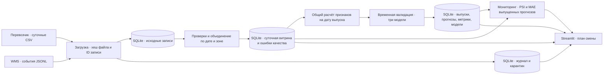

# Складская логистика

Проектный практикум, вариант 14. Прототип прогнозирует суточный объём отгрузок в палетах и долю занятых на конец дня складских ячеек в каждой зоне. Дашборд помогает начальнику смены заранее увидеть пики отгрузок и дни с риском нехватки ячеек. Вместимость зон, горизонт прогноза и порог загрузки задаются в [config.toml](config.toml).

## Запуск на Windows

Нужен Python 3.11. Выполните команды в PowerShell из корня репозитория.

```powershell
python -m venv .venv
.\.venv\Scripts\python.exe -m pip install -r requirements.txt
.\.venv\Scripts\python.exe -m warehouse demo
.\.venv\Scripts\python.exe -m streamlit run dashboard.py
```

Откройте `http://localhost:8501`. Команда `demo` создаёт два набора синтетических данных, загружает их, проверяет качество и публикует прогноз. SQLite и файлы источников создаются в `data/`. При первом запуске дашборда демоданные также можно создать кнопкой в интерфейсе.

В другом терминале можно продемонстрировать повторную и инкрементальную загрузку.

```powershell
.\.venv\Scripts\python.exe -m warehouse run
.\.venv\Scripts\python.exe -m warehouse demo --through 2026-11-26
.\.venv\Scripts\python.exe -m warehouse status
.\.venv\Scripts\python.exe -m unittest discover -s tests -v
```

Первый повторный `run` показывает ноль новых записей. Команда `demo --through` продлевает входные файлы до заданной даты. Дашборд опрашивает опубликованный выпуск каждые 15 секунд. Для регулярной обработки можно запускать `python -m warehouse run` планировщиком. Переменная `WAREHOUSE_CONFIG` задаёт альтернативный TOML для CLI и дашборда. Пути отсчитываются от самого TOML.

## Архитектура



Python и pandas обрабатывают данные и признаки, SQLite хранит исходные записи и результаты, scikit-learn обучает модели, Streamlit и Plotly отображают данные. Прототип разворачивается локально и работает с файловыми источниками без внешних сервисов.

## Источники и контроль качества

| Источник | Формат и поля | Данные в витрине |
| --- | --- | --- |
| Реестр перевозчика | UTF-8 CSV с заголовком `id,date,zone,pallets` и одной строкой на дату и зону | Суточный объём отгрузок в палетах |
| Журнал WMS | UTF-8 JSONL. Общие поля `id`, `timestamp`, `type` и `payload.location.zone`. В `payload.details` хранятся поля события | `inventory.snapshot` содержит `occupied_cells`, `receiving.closed` содержит суточные `pallets` |

Один CSV-реестр и по одному событию каждого значимого типа на зону и день считаются закрытым суточным фактом. Время WMS задано в локальном времени склада. Заполненность вычисляется как число занятых ячеек, делённое на вместимость зоны. Значения занятости вне вместимости и объёмы палет вне диапазона от нуля до пяти вместимостей помечаются как аномалии.

Хеш избавляет от повторного разбора неизменившихся файлов. Ключ из имени источника и ID защищает от дублей в новых или расширенных файлах. ID закреплён за исходным содержимым. Конфликты ID и некорректный синтаксис регистрируются в карантине. Несколько записей на одно измерение и день, пропуски и аномалии отмечаются в суточной витрине. Невалидный факт исключается из обучения только для соответствующей цели. При временной недоступности файла чтение повторяется. При недоступности источника сохраняется предыдущий выпуск прогноза.

Синтетическая история охватывает три зоны с 01.01.2025 по 24.11.2026. Она включает недельную и годовую сезонность, локальные колебания, пропуски и ошибки. Генератор воспроизводится при зерне `42`.

Через раздел **Данные** можно передать свои CSV и JSONL, просмотреть журнал и признаки по зоне. Файлы добавляются в текущий набор, повторная загрузка того же содержимого сохраняет одну копию. Для отдельной истории создайте TOML с отдельными путями базы и файлов и укажите его в `WAREHOUSE_CONFIG`.

## Модели и временная проверка

- Базовая модель берёт факт того же дня недели. При пропуске она использует последнее суточное значение, среднее за неделю или медиану обучающей выборки.
- Ridge и гистограммный градиентный бустинг обучаются на лагах, средних за 7 и 28 дней, сезонных кодах и горизонте. Зона и день недели кодируются one-hot, чтобы избежать искусственного порядка категорий. Медианы для пропусков в признаках оцениваются на обучающем окне.
- Для обеих ML-моделей сравниваются варианты с признаками приёмки WMS и без них. Для бустинга параметр `search_budget` ограничивает число наборов гиперпараметров. При бюджете 3 есть девять кандидатов на показатель, включая сезонный прогноз и два варианта Ridge. Действующая конфигурация тоже участвует в сравнении при снижении бюджета.
- В трёх последовательных окнах обучение включает только факты с датой раньше первого выпуска в проверочном окне. Конфигурация с минимальной MAE проверяется на отдельном 42-дневном периоде. Для будущих прогнозов она переобучается на всех доступных закрытых фактах.
- MAE показывает среднее абсолютное отклонение в палетах или процентных пунктах. RMSE сильнее учитывает крупные ошибки. Обе метрики измеряются в исходных единицах показателя.

В прогоне для отчёта с фактами по 26 ноября 2026 года MAE бустинга составила **8,02 палеты** для отгрузок и **3,24 п. п.** для загрузки. Базовые ошибки составили 13,25 палеты и 10,87 п. п. Даты выпуска отложенных прогнозов охватывают период с 9 октября по 19 ноября 2026 года. Метрики относятся к синтетическому складу.

## Дашборд и управление выпусками

- **Прогноз** показывает факт, прогноз и решение для выбранной зоны. Можно оценить пик отгрузок и дни, когда нужно проверить свободные ячейки.
- **Модели и контроль** показывает сравнение моделей и их параметров, объяснения, мониторинг и реестр выпусков. При поступлении фактов новая конфигурация публикуется при улучшении MAE хотя бы на `promotion_threshold` (1% по умолчанию) на одинаковых окнах. Действующая конфигурация также переобучается на обновлённой истории.
- **Данные** принимает файлы из браузера и показывает журнал загрузок, причины отбраковки и таблицу признаков.

Мониторинг сравнивает распределения входных показателей с предыдущим периодом по PSI. Ошибки рассчитываются по прогнозам, выпущенным до факта. По умолчанию рекомендация переобучить появляется при PSI от 0,20 или росте MAE свыше 25% относительно отложенной ошибки предыдущего выпуска при наличии минимум 12 совпавших фактов. Результаты проверок сохраняются в SQLite. Сезонные эффекты могут давать сигнал PSI даже при небольшой ошибке.

Для каждого текущего эксперимента сохраняются настройки, зерно, снимок данных, контрольная сумма и метрики. Кнопка **Воспроизвести эксперимент** пересчитывает результаты. Ручная активация версии возвращает её прогноз на исходную дату. Запуск с тем же набором сохраняет выбранный выпуск. Версии можно выбрать в интерфейсе или в терминале по однозначному префиксу из `status`.

```powershell
$release = '4c4891469b20'
.\.venv\Scripts\python.exe -m warehouse replay $release
.\.venv\Scripts\python.exe -m warehouse activate $release
```

## Проверки по этапам

| Этап | Проверка |
| --- | --- |
| 1. Источники | Повторная генерация сохраняет ранее созданные строки, продление добавляет новый день |
| 2. Загрузка и витрина | Дубли исключаются, ошибки изолируются, пропуск факта отличим от нуля |
| 3. Признаки | Подмена будущих фактов меняет цели, признаки более ранних выпусков сохраняются |
| 4. Модели | В каждом окне факты обучения строго раньше выпусков проверочных прогнозов |
| 5. Дашборд | Выбор зоны и показателя обновляет факт, семидневный прогноз и порог загрузки |
| 6. Объяснения | Сумма вкладов и опорное значение совпадают с отдельным прогнозом |
| 7. Сквозной запуск | Повтор использует тот же выпуск, при отключении источника предыдущий выпуск доступен |
| 8. Эксперименты и мониторинг | Снимок воспроизводит метрики, PSI реагирует на изменение распределения, откат сохраняется при повторном запуске |

В разделе «Объяснения» можно выбрать зону, дату и горизонт. Для отдельного прогноза показано разложение по признакам относительно опорной строки. Для двух половин отложенного периода доступны важность при перемешивании и средний абсолютный вклад. График частичной зависимости показывает реакцию модели на изменение одного признака.

Материалы к защите в каталоге `docs` включают [отчёт в PDF](docs/warehouse-report.pdf), [редактируемый отчёт](docs/warehouse-report-variant-14.docx) и [презентацию](docs/warehouse-defense.pptx).

## Ограничения

Прототип предполагает, что дневные данные обычно доступны к закрытию дня. Для исторических данных со значительными опозданиями потребуется хранить время фактической доступности и воссоздавать срез на дату выпуска. Для планирования используется точечный прогноз и порог загрузки 90%. Вероятность превышения порога потребует оценки неопределённости.
